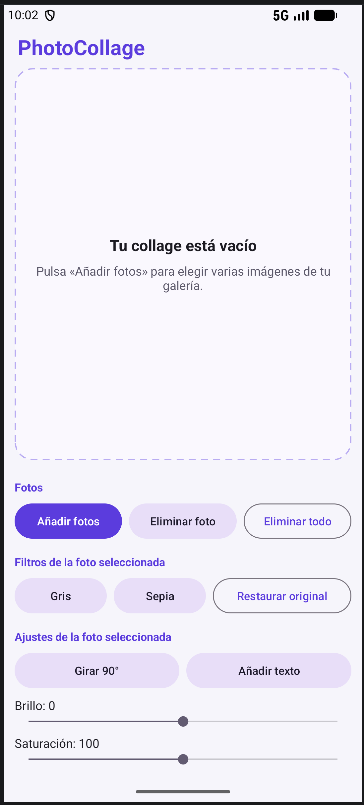
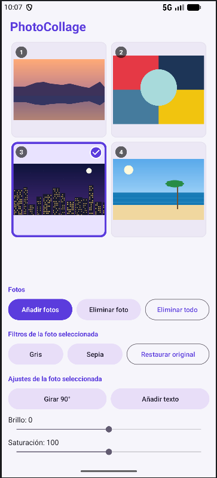
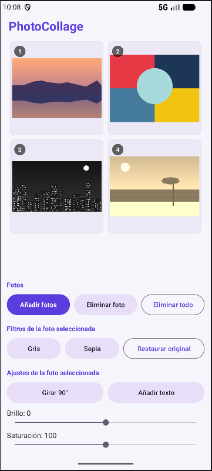
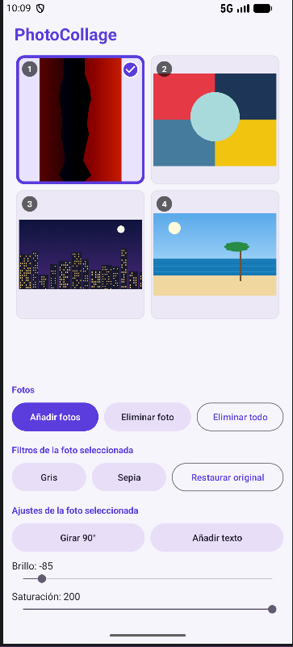
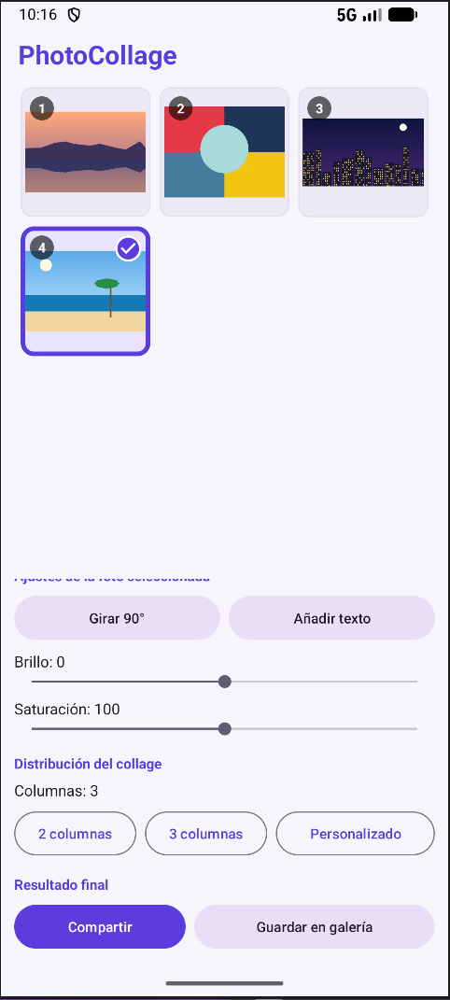
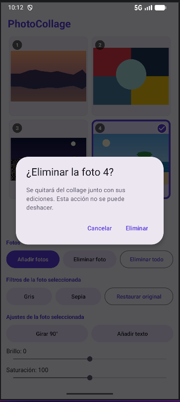

# PhotoCollage

Aplicación Android para crear collages: eliges varias fotos de la galería, las ves en una
cuadrícula, editas cada una (filtros, giro, brillo, saturación, texto) y compartes o guardas el
collage final como una sola imagen.

Proyecto del examen práctico de Kotlin de 2.º DAM — Abel Carballeira.

## Funcionalidades

| Bloque | Qué hace la app |
|---|---|
| Interfaz | Título «PhotoCollage», zona central con el collage, botones de añadir, eliminar foto, eliminar todo, filtros y restaurar original. Se adapta a móvil en vertical, en horizontal y a tablets (ver «Adaptación a pantallas»). |
| Selección múltiple | Photo Picker del sistema (`PickMultipleVisualMedia`): se pueden elegir varias fotos a la vez, la pantalla se actualiza con cada foto que entra, no se admiten fotos repetidas (se avisa de cuántas se han ignorado) y, si no hay ninguna, se muestra el mensaje «Tu collage está vacío». |
| Cuadrícula | `RecyclerView` + `GridLayoutManager` + `ListAdapter`. Cada foto se ve entera, sin deformarse (`fitCenter` en una celda cuadrada), con un número que la identifica. Se actualiza al añadir y al eliminar. |
| Selección y borrado | Un toque selecciona la foto (borde violeta y marca); solo puede haber una seleccionada y volver a tocarla la deselecciona. «Eliminar foto» avisa si no hay ninguna seleccionada y, si la hay, pide confirmación con un `AlertDialog` antes de borrarla. «Eliminar todo» también pide confirmación con un `AlertDialog`. |
| Filtros | Gris, sepia y «Restaurar original», programados en Kotlin con `ColorMatrix` (sin apps ni librerías externas). La foto original nunca se modifica: los ajustes se aplican siempre sobre una copia. El efecto se ve al instante y, si no hay foto seleccionada, la app lo indica. |
| Giro y brillo | «Girar 90°» gira en sentido horario y suma 90° en cada pulsación (0 → 90 → 180 → 270 → 0). El brillo es un `SeekBar` cuyo valor inicial es el de la foto original; sube y baja y la imagen se actualiza mientras se mueve (el cálculo se hace en segundo plano, ver «Decisiones técnicas»). |
| Compartir | Genera una imagen JPEG con todas las fotos tal y como se ven y la envía con `Intent.ACTION_SEND` usando `FileProvider`. Con el collage vacío no genera nada y avisa; si hay ediciones sin terminar de calcular, espera a que acaben para exportar exactamente lo que se ve. |
| Organización | Pocos ficheros, cada uno con una responsabilidad; el estado vive en un `ViewModel`, así que las fotos y sus ajustes se conservan al girar la pantalla. |

### Ampliaciones voluntarias

| Ampliación | Cómo está hecha |
|---|---|
| Filtro de saturación | Deslizador de 0 a 200 (100 = original) con `ColorMatrix.setSaturation`. |
| Texto sobre la foto | Botón «Añadir texto»: texto propio, tamaño (deslizador) y posición (arriba, centro o abajo). Se dibuja en blanco con contorno negro para que se lea sobre cualquier foto. |
| Guardar en el dispositivo | «Guardar en galería» crea la imagen en `Imágenes/PhotoCollage` con `MediaStore` (sin permisos en Android 10 o superior; en Android 9 o inferior pide `WRITE_EXTERNAL_STORAGE` en tiempo de ejecución). |
| Cambiar la distribución | «2 columnas», «3 columnas» y «Personalizado» (de 1 a 6 columnas). La imagen exportada usa la distribución elegida. |

### Qué hace la app cuando algo sale mal

- **Collage vacío:** «Compartir» y «Guardar en galería» avisan («El collage está vacío: añade fotos primero») y no crean ningún fichero.
- **Selector de fotos:** si se cierra sin elegir nada no pasa nada; las fotos repetidas y las que no se pueden leer se ignoran y la app dice cuántas.
- **Compartir o guardar:** los fallos de `FileProvider` o `MediaStore` se capturan, se muestra un mensaje y la app no se cierra. Un segundo toque mientras se genera la imagen se ignora.
- **Poca memoria:** si falta memoria al editar una foto o al generar el collage se muestra un mensaje; la foto vuelve a los últimos ajustes que sí se pudieron calcular.
- **Progreso:** hay un indicador visible mientras se leen fotos o se genera la imagen del collage.

## Cómo se usa

1. Pulsa **Añadir fotos** y elige una o varias imágenes.
2. Toca una foto para seleccionarla. Con ella seleccionada puedes aplicar **Gris**, **Sepia**,
   **Restaurar original**, **Girar 90°**, mover **Brillo** y **Saturación** o pulsar **Añadir texto**.
3. **Eliminar foto** quita la seleccionada y **Eliminar todo** vacía el collage; ambos piden confirmación.
4. Elige las columnas del collage en «Distribución del collage».
5. **Compartir** abre el selector de aplicaciones; **Guardar en galería** guarda la imagen.

## Cómo ejecutar el proyecto

Requisitos: Android Studio reciente con el SDK de Android 37 instalado, y un emulador o un móvil
con Android 7.0 (API 24) o superior.

1. Abre la carpeta del proyecto con **File → Open**.
2. Espera a que termine la sincronización de Gradle.
3. Selecciona un dispositivo y pulsa **Run ▶**.
4. Para probar en el emulador necesitas fotos en su galería: arrastra imágenes a la ventana del
   emulador o ábrelas desde la app Fotos del emulador.

La ruta del proyecto contiene la «ó» de «Fundación»; por eso `gradle.properties` incluye
`android.overridePathCheck=true`.

Para ejecutar los tests unitarios (no necesitan móvil ni emulador): **clic derecho sobre
`app/src/test` → Run Tests**, o `./gradlew testDebugUnitTest` desde la carpeta del proyecto.

Para ejecutar los tests instrumentados (necesitan un emulador o un móvil ya arrancado, con Android 7.0
o superior): **clic derecho sobre `app/src/androidTest` → Run Tests**, o
`./gradlew connectedDebugAndroidTest`.

## Adaptación a pantallas

- `layout/activity_main.xml` (móvil en vertical): título, collage arriba (5/9 de la altura) y
  controles con scroll debajo (4/9).
- `layout-land/activity_main.xml` (horizontal, y también tablets apaisadas): el collage a la
  izquierda y los controles con scroll a la derecha.
- Los dos diseños comparten `panel_controls.xml` mediante `<include>`.
- Todas las medidas están en `dp`/`sp`, los botones se reparten con `layout_weight` y la
  pantalla respeta las barras del sistema y el notch (*edge-to-edge* con *insets*).
- El número de columnas del collage lo elige el usuario; las celdas son cuadradas y se ajustan
  solas al ancho disponible.

## Estructura

```
app/src/main/java/com/abelcarballeira/photocollage/
├── MainActivity.kt         Pantalla única: conecta botones, deslizadores y diálogos con el ViewModel
├── CollageViewModel.kt     Estado del collage (StateFlow), operaciones y cálculo de imágenes en segundo plano
├── Models.kt               Photo, EditSettings, PhotoFilter, PhotoText, CollageState
├── ImageProcessor.kt       Lectura reducida con EXIF, filtros, giro, brillo, saturación y texto
├── CollageExporter.kt      Imagen final del collage, compartir (FileProvider) y guardar (MediaStore)
├── CollageLogic.kt         Reglas puras (giro, brillo, duplicados, columnas, distribución del collage,
│                           matriz de color de filtros/brillo/saturación) para poder probarlas sin Android
├── PhotoAdapter.kt         Adaptador de la cuadrícula (ListAdapter + DiffUtil)
└── SquareFrameLayout.kt    Celda cuadrada
app/src/main/res/           Layouts, textos en español, colores, tema Material 3 e iconos
app/src/test/               Tests unitarios JVM: CollageLogicTest y ColorMatrixTest
app/src/androidTest/        Tests instrumentados: ImageProcessor, CollageExporter y CollageViewModel (+ TestSupport)
```

## Decisiones técnicas

- **Edición no destructiva.** `Photo.original` nunca se toca. Cada cambio (filtro, giro, brillo,
  saturación, texto) guarda solo sus valores y `ImageProcessor.render` genera una imagen nueva a
  partir de la original. «Restaurar original» devuelve los valores por defecto.
- **Orden de los ajustes:** saturación → filtro (gris o sepia) → brillo, y después el texto.
  El texto se dibuja siempre horizontal, aunque la foto esté girada.
- **Edición en segundo plano.** Los ajustes de una foto se guardan al instante en el estado, pero la
  imagen resultante se calcula con `Dispatchers.Default`, nunca en el hilo principal. Hay como mucho
  un cálculo por foto: si llegan más cambios mientras se calcula (por ejemplo, al arrastrar un
  deslizador) no se lanzan cálculos nuevos, el mismo cálculo se repite al terminar con los ajustes
  más recientes. Así se saltan los valores intermedios y una edición antigua nunca sustituye a una
  más nueva. Al eliminar una foto se cancela su cálculo.
- **Memoria.** Cada foto se lee reducida (lado mayor de 1024 px, unos 4 MB como máximo) con
  `inSampleSize` y se corrige su orientación EXIF; si no hay ajustes no se crea una segunda copia,
  y cada edición parte siempre de la original, así que no se acumula pérdida de calidad. La imagen
  final del collage se libera (`Bitmap.recycle()`) cuando ya se ha compartido o guardado. Al eliminar
  una foto solo se suelta la referencia para que el recolector la libere: no se hace `recycle()`
  porque la lista puede estar todavía dibujándola durante la animación.
- **`largeHeap="true"`.** Se mantiene como margen de seguridad (una foto editada ocupa su original
  más su copia editada; con muchas fotos puede superarse el límite normal de un móvil). No se ha
  medido el consumo real en un dispositivo. Si aun así falta memoria, la app avisa en lugar de cerrarse.
- **Estado.** `CollageViewModel` conserva fotos y ajustes al girar el móvil. No se guardan al
  cerrar la app del todo.
- **Matriz de color en Kotlin puro.** `CollageLogic.colorMatrix` calcula la matriz 4×5 (saturación →
  filtro → brillo) sin depender de Android, con las mismas operaciones que `ColorMatrix` de Android;
  así se prueba con tests JVM. Un test instrumentado (aún sin ejecutar, ver «Pruebas») la compara
  con la clase real de Android.
- **Permisos.** Para leer fotos no se pide ninguno (Photo Picker). Solo se pide
  `WRITE_EXTERNAL_STORAGE` en Android 9 o inferior para guardar en la galería.

## Pruebas

- **Tests unitarios** (`app/src/test`, 33 tests, sin móvil ni emulador): ejecutados con Gradle desde
  Android Studio el 18/11/2026 — **33 de 33 superados**.
  - `CollageLogicTest` (18): giro de 90° en 90° y normalización de vueltas, límites del brillo y la
    saturación, fotos repetidas, tamaño de lectura, límites de columnas (1 a 6), distribución y tamaño
    del collage exportado (posiciones, huecos, nunca vacío ni gigante).
  - `ColorMatrixTest` (15): matriz de color de gris, sepia, «restaurar original» (devuelve la
    identidad), que el resultado no depende del historial de ajustes, brillo, saturación y sus
    combinaciones.
- **Tests instrumentados** (`app/src/androidTest`, 35 tests escritos): comprueban con `Bitmap` reales
  gris, sepia, restaurar, combinación de brillo + saturación + giro (contra el `ColorMatrix` de
  Android), generación del collage y límites de columnas, `FileProvider`, `MediaStore`, collage vacío
  (no se comparte ni se guarda), una edición antigua que no pisa a una nueva, borrar mientras se
  edita, y que fotos y ajustes sobreviven a un giro de pantalla. **Compilan y se empaquetan
  correctamente con Gradle, pero NO se han ejecutado todavía**: el emulador de este equipo no llegó a
  terminar de arrancar y Android Studio no pudo instalar la app («device is still booting»), por lo que
  no hay ningún resultado de estos tests. Hay que ejecutarlos con un emulador o móvil ya arrancado
  (ver «Cómo ejecutar el proyecto»).
- **Prueba manual** en el emulador de Android Studio (Medium Phone, API 37), con las fotos de ejemplo de su galería, el 18/11/2026. No se ha probado en un móvil físico. Esta tabla se hizo antes de pasar el cálculo de las imágenes a segundo plano y de añadir el indicador de progreso al generar el collage: **conviene repetirla** con la versión actual.

| Prueba | Resultado |
|---|---|
| Añadir varias fotos a la vez | ✔ Correcto |
| Añadir otra vez las mismas fotos (no se duplican) | ✔ Correcto |
| Mensaje de collage vacío al principio y tras «Eliminar todo» | ✔ Correcto |
| Seleccionar una foto (borde) y seleccionar otra (solo una) | ✔ Correcto |
| Eliminar foto sin selección (mensaje) y con selección → Cancelar / Eliminar | ✔ Correcto |
| Eliminar todo → Cancelar / Eliminar | ✔ Correcto |
| Gris, Sepia y Restaurar original | ✔ Correcto |
| Filtro sin foto seleccionada (mensaje) | ✔ Correcto |
| Girar 90° cuatro veces | ✔ Correcto |
| Brillo arriba y abajo (en tiempo real) | ✔ Correcto |
| Saturación | ✔ Correcto |
| Añadir y quitar texto | ✔ Correcto |
| 2 columnas, 3 columnas y personalizado | ✔ Correcto |
| Girar el móvil (las fotos y ajustes se mantienen) | ✔ Correcto |
| Compartir | ✔ Correcto |
| Guardar en galería | ✔ Correcto |

## Capturas de pantalla

Capturas reales tomadas en el emulador de Android Studio (Medium Phone, API 37). Están en la carpeta [`screenshots/`](screenshots/).

<table>
  <tr>
    <td align="center"><br>Collage vacío</td>
    <td align="center"><br>Varias fotos en dos columnas</td>
    <td align="center"><br>Foto seleccionada</td>
  </tr>
  <tr>
    <td align="center"><br>Filtros gris y sepia</td>
    <td align="center"><br>Giro, brillo y saturación</td>
    <td align="center"><br>Texto sobre una foto</td>
  </tr>
  <tr>
    <td align="center"><br>Tres columnas</td>
    <td align="center"><br>Confirmar «Eliminar foto»</td>
    <td align="center"><br>Confirmar «Eliminar todo»</td>
  </tr>
  <tr>
    <td align="center"><br>Compartir el collage</td>
  </tr>
</table>

<p align="center"><br>App en horizontal</p>

## Repositorio

Código fuente: <https://github.com/abelcv007-cmyk/PhotoCollage>

Para descargarlo: `git clone https://github.com/abelcv007-cmyk/PhotoCollage.git` y abrir la carpeta con Android Studio (*File ▸ Open*).
