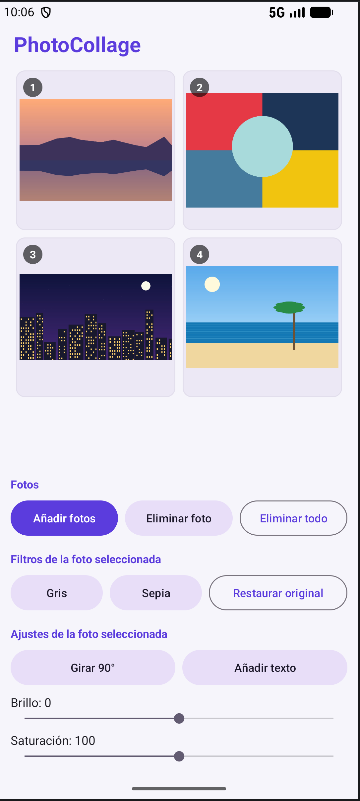
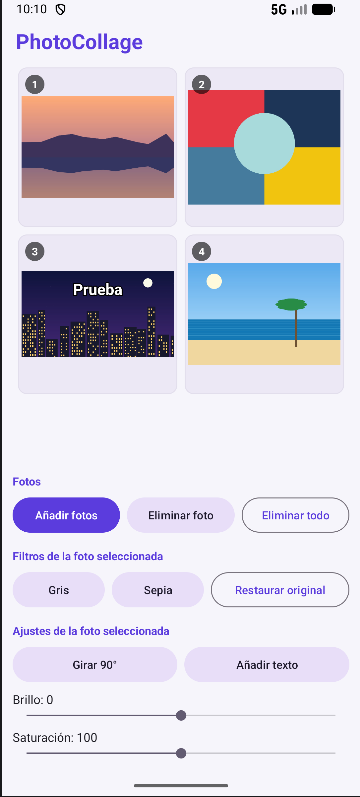
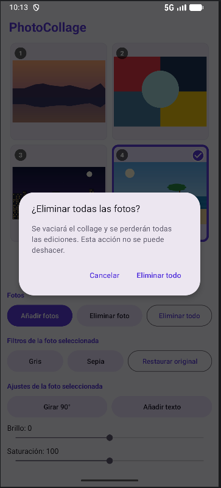
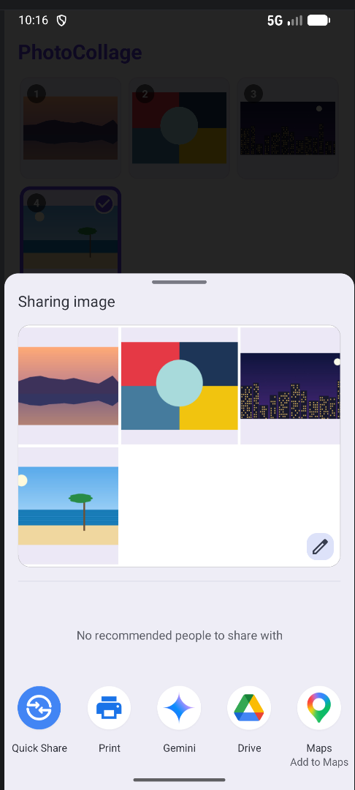
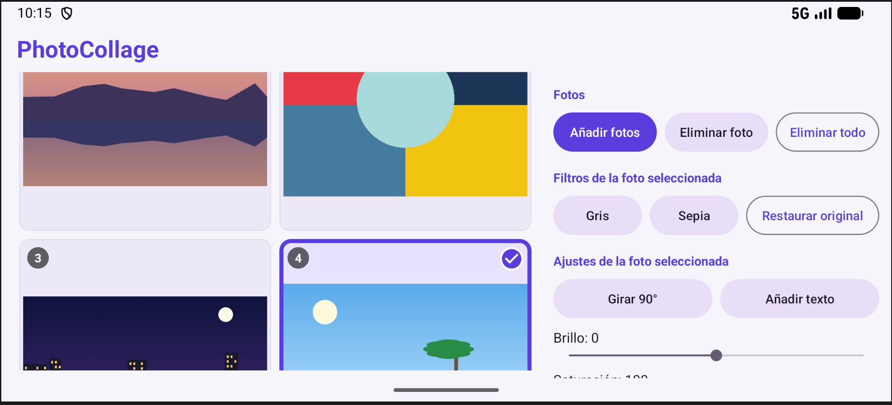

# PhotoCollage

Aplicación Android para crear collages: eliges varias fotos de la galería, las ves en una
cuadrícula, editas cada una (filtros, giro, brillo, saturación, texto) y compartes o guardas el
collage final como una sola imagen.

Proyecto del examen práctico de Kotlin de 2.º DAM — Abel Carballeira.

## Funcionalidades

| Bloque | Qué hace la app |
|---|---|
| Interfaz | Título «PhotoCollage», zona central con el collage, botones de añadir, eliminar foto, eliminar todo, filtros y restaurar original. Se adapta a móvil en vertical, en horizontal y a tablets (ver «Adaptación a pantallas»). |
| Selección múltiple | Photo Picker del sistema (`PickMultipleVisualMedia`): se pueden elegir varias fotos a la vez, la pantalla se actualiza con cada foto que entra, no se admiten fotos repetidas (se avisa de cuántas se han ignorado) y, si no hay ninguna, se muestra el mensaje «Tu collage está vacío». |
| Cuadrícula | `RecyclerView` + `GridLayoutManager` + `ListAdapter`. Cada foto se ve entera, sin deformarse (`fitCenter` en una celda cuadrada), con un número que la identifica. Se actualiza al añadir y al eliminar. |
| Selección y borrado | Un toque selecciona la foto (borde violeta y marca); solo puede haber una seleccionada y volver a tocarla la deselecciona. «Eliminar foto» avisa si no hay ninguna seleccionada y, si la hay, pide confirmación con un `AlertDialog` antes de borrarla. «Eliminar todo» también pide confirmación con un `AlertDialog`. |
| Filtros | Gris, sepia y «Restaurar original», programados en Kotlin con `ColorMatrix` (sin apps ni librerías externas). La foto original nunca se modifica: los ajustes se aplican siempre sobre una copia. El efecto se ve al instante y, si no hay foto seleccionada, la app lo indica. |
| Giro y brillo | «Girar 90°» gira en sentido horario y suma 90° en cada pulsación (0 → 90 → 180 → 270 → 0). El brillo es un `SeekBar` cuyo valor inicial es el de la foto original; sube y baja y se actualiza en tiempo real. |
| Compartir | Genera una imagen JPEG con todas las fotos tal y como se ven y la envía con `Intent.ACTION_SEND` usando `FileProvider`. |
| Organización | Pocos ficheros, cada uno con una responsabilidad; el estado vive en un `ViewModel`, así que las fotos y sus ajustes se conservan al girar la pantalla. |

### Ampliaciones voluntarias

| Ampliación | Cómo está hecha |
|---|---|
| Filtro de saturación | Deslizador de 0 a 200 (100 = original) con `ColorMatrix.setSaturation`. |
| Texto sobre la foto | Botón «Añadir texto»: texto propio, tamaño (deslizador) y posición (arriba, centro o abajo). Se dibuja en blanco con contorno negro para que se lea sobre cualquier foto. |
| Guardar en el dispositivo | «Guardar en galería» crea la imagen en `Imágenes/PhotoCollage` con `MediaStore` (sin permisos en Android 10 o superior; en Android 9 o inferior pide `WRITE_EXTERNAL_STORAGE` en tiempo de ejecución). |
| Cambiar la distribución | «2 columnas», «3 columnas» y «Personalizado» (de 1 a 6 columnas). La imagen exportada usa la distribución elegida. |

## Cómo se usa

1. Pulsa **Añadir fotos** y elige una o varias imágenes.
2. Toca una foto para seleccionarla. Con ella seleccionada puedes aplicar **Gris**, **Sepia**,
   **Restaurar original**, **Girar 90°**, mover **Brillo** y **Saturación** o pulsar **Añadir texto**.
3. **Eliminar foto** quita la seleccionada y **Eliminar todo** vacía el collage; ambos piden confirmación.
4. Elige las columnas del collage en «Distribución del collage».
5. **Compartir** abre el selector de aplicaciones; **Guardar en galería** guarda la imagen.

## Cómo ejecutar el proyecto

Requisitos: Android Studio reciente con el SDK de Android 37 instalado, y un emulador o un móvil
con Android 7.0 (API 24) o superior.

1. Abre la carpeta del proyecto con **File → Open**.
2. Espera a que termine la sincronización de Gradle.
3. Selecciona un dispositivo y pulsa **Run ▶**.
4. Para probar en el emulador necesitas fotos en su galería: arrastra imágenes a la ventana del
   emulador o ábrelas desde la app Fotos del emulador.

La ruta del proyecto contiene la «ó» de «Fundación»; por eso `gradle.properties` incluye
`android.overridePathCheck=true`.

Para ejecutar los tests unitarios: **clic derecho sobre `app/src/test` → Run Tests**, o
`./gradlew test` desde la carpeta del proyecto.

## Adaptación a pantallas

- `layout/activity_main.xml` (móvil en vertical): título, collage arriba (5/9 de la altura) y
  controles con scroll debajo (4/9).
- `layout-land/activity_main.xml` (horizontal, y también tablets apaisadas): el collage a la
  izquierda y los controles con scroll a la derecha.
- Los dos diseños comparten `panel_controls.xml` mediante `<include>`.
- Todas las medidas están en `dp`/`sp`, los botones se reparten con `layout_weight` y la
  pantalla respeta las barras del sistema y el notch (*edge-to-edge* con *insets*).
- El número de columnas del collage lo elige el usuario; las celdas son cuadradas y se ajustan
  solas al ancho disponible.

## Estructura

```
app/src/main/java/com/abelcarballeira/photocollage/
├── MainActivity.kt         Pantalla única: conecta botones, deslizadores y diálogos con el ViewModel
├── CollageViewModel.kt     Estado del collage (StateFlow) y todas las operaciones
├── Models.kt               Photo, PhotoFilter, PhotoText, CollageState
├── ImageProcessor.kt       Lectura reducida con EXIF, filtros, giro, brillo, saturación y texto
├── CollageExporter.kt      Imagen final del collage, compartir (FileProvider) y guardar (MediaStore)
├── CollageLogic.kt         Reglas puras (giro, brillo, duplicados, tamaños) para poder probarlas
├── PhotoAdapter.kt         Adaptador de la cuadrícula (ListAdapter + DiffUtil)
└── SquareFrameLayout.kt    Celda cuadrada
app/src/main/res/           Layouts, textos en español, colores, tema Material 3 e iconos
app/src/test/               Tests unitarios de CollageLogic
```

## Decisiones técnicas

- **Edición no destructiva.** `Photo.original` nunca se toca. Cada cambio (filtro, giro, brillo,
  saturación, texto) guarda solo sus valores y `ImageProcessor.render` genera una imagen nueva a
  partir de la original. «Restaurar original» devuelve los valores por defecto.
- **Orden de los ajustes:** saturación → filtro (gris o sepia) → brillo, y después el texto.
  El texto se dibuja siempre horizontal, aunque la foto esté girada.
- **Memoria.** Cada foto se lee reducida (lado mayor de 1024 px) con `inSampleSize` y se corrige
  su orientación EXIF; si no hay ajustes no se crea una segunda copia.
- **Estado.** `CollageViewModel` conserva fotos y ajustes al girar el móvil. No se guardan al
  cerrar la app del todo.
- **Permisos.** Para leer fotos no se pide ninguno (Photo Picker). Solo se pide
  `WRITE_EXTERNAL_STORAGE` en Android 9 o inferior para guardar en la galería.

## Pruebas

- **Tests unitarios** (`app/src/test`, 10 tests de `CollageLogic`): giro de 90° en 90°, límites
  del brillo y la saturación, fotos repetidas, tamaño de lectura y tamaño del collage exportado.
- **Prueba manual** en el emulador de Android Studio (Medium Phone, API 37), con las fotos de ejemplo de su galería, el 18/11/2026. No se ha probado en un móvil físico.

| Prueba | Resultado |
|---|---|
| Añadir varias fotos a la vez | ✔ Correcto |
| Añadir otra vez las mismas fotos (no se duplican) | ✔ Correcto |
| Mensaje de collage vacío al principio y tras «Eliminar todo» | ✔ Correcto |
| Seleccionar una foto (borde) y seleccionar otra (solo una) | ✔ Correcto |
| Eliminar foto sin selección (mensaje) y con selección → Cancelar / Eliminar | ✔ Correcto |
| Eliminar todo → Cancelar / Eliminar | ✔ Correcto |
| Gris, Sepia y Restaurar original | ✔ Correcto |
| Filtro sin foto seleccionada (mensaje) | ✔ Correcto |
| Girar 90° cuatro veces | ✔ Correcto |
| Brillo arriba y abajo (en tiempo real) | ✔ Correcto |
| Saturación | ✔ Correcto |
| Añadir y quitar texto | ✔ Correcto |
| 2 columnas, 3 columnas y personalizado | ✔ Correcto |
| Girar el móvil (las fotos y ajustes se mantienen) | ✔ Correcto |
| Compartir | ✔ Correcto |
| Guardar en galería | ✔ Correcto |

## Capturas de pantalla

Capturas reales tomadas en el emulador de Android Studio (Medium Phone, API 37). Están en la carpeta [`screenshots/`](screenshots/).

<table>
  <tr>
    <td align="center"><br>Collage vacío</td>
    <td align="center"><br>Varias fotos en dos columnas</td>
    <td align="center"><br>Foto seleccionada</td>
  </tr>
  <tr>
    <td align="center"><br>Filtros gris y sepia</td>
    <td align="center"><br>Giro, brillo y saturación</td>
    <td align="center"><br>Texto sobre una foto</td>
  </tr>
  <tr>
    <td align="center"><br>Tres columnas</td>
    <td align="center"><br>Confirmar «Eliminar foto»</td>
    <td align="center"><br>Confirmar «Eliminar todo»</td>
  </tr>
  <tr>
    <td align="center"><br>Compartir el collage</td>
  </tr>
</table>

<p align="center"><br>App en horizontal</p>

## Repositorio

Pendiente de subir a GitHub. La URL se entrega en el campus virtual.
